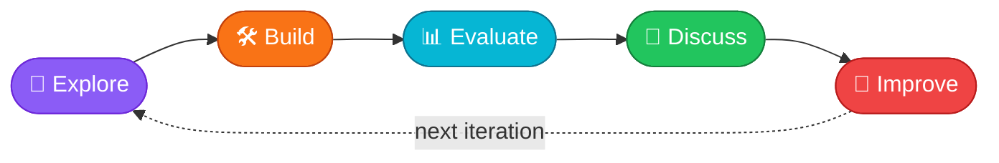

 

 

> **Welcome to AI Workshop II.** This is a hands-on research and engineering workshop where we explore modern AI, build real systems, run experiments, and learn by doing. No fixed lecture treadmill. We build projects, share progress, discuss challenges, and chase new ideas together.

---

# ✅ MONDAY CHECK-IN

Opens by itself every <b>Monday 17:00 – 18:00 (ICT)</b>. No login, just your Student ID and name.

  

 

🔗 <a href="https://kaopanboonyuen.github.io/CP412704_AIWorkshopII_2026s2/">kaopanboonyuen.github.io/CP412704_AIWorkshopII_2026s2</a>

 

---

# 🚨 START HERE · 2 Things Every Student Must Do

Complete both before our next session. It takes less than five minutes.

 

<table>
<tr>
<td width="50%" valign="top">

### 🧑‍🤝‍🧑 &nbsp;1 · Register Your Team

**Every group fills in the team sheet first.**

- ✅ Team name
- ✅ All team members
- 💡 Your project topic or interest, **if you have one**

> [!TIP]
> **No topic yet? No problem.** Leave it blank and we will find the right one together.

 

</td>
<td width="50%" valign="top">

### 🎥 &nbsp;2 · Join Class on Zoom

**Every Monday · 17:00 – 20:00 (ICT)**

| Time | What happens |
|:--|:--|
| 🕔 **17:00 – 18:00** | Class session together |
| 🕕 **18:00 – 20:00** | Lab time or group consultation in breakouts |

> [!IMPORTANT]
> Stay for the full block. Lab hours are where the building happens.

</td>
</tr>
</table>

 

---

## 👨‍🏫 Instructor

<table>
<tr>
<td width="140" align="center">

</td>
<td>

**Teerapong Panboonyuen (P'Kao), Ph.D.**
Adjunct Professor, College of Computing, Khon Kaen University

</td>
</tr>
</table>

**Research interests**

---

## 🔁 How We Work

We meet weekly to share progress, demo experiments, discuss challenges, and plan next steps. Think **lab meeting**, not lecture hall.

---

## 🗓️ Week 01 · Welcome & Project Kickoff

Let's meet, exchange ideas, and decide what we want to build.

### 📋 Agenda

| # | Session | What we cover |
|:-:|:--|:--|
| 1 | 👋 **Meet P'Kao** | Introduction and course expectations |
| 2 | 🌏 **Modern AI Landscape** | Computer Vision, LLMs, Local AI, ASR, and Reinforcement Learning |
| 3 | 💡 **Project Brainstorming** | Interesting problems and potential AI projects |
| 4 | 🧭 **Research & Engineering Directions** | Models, datasets, tools, and possible experiments |
| 5 | 🤝 **Lab Meeting Format** | Weekly progress updates and project discussions |

### 🧪 Initial Project Ideas

| | Track | The idea |
|:-:|:--|:--|
| 🤖 | **Local LLM** | Build an AI assistant using open-weight models |
| 🎛️ | **LLM Fine-tuning** | Adapt pretrained models with LoRA or other PEFT methods |
| 📚 | **AI Knowledge Systems** | Intelligent document understanding and retrieval systems |
| 👁️ | **Computer Vision** | Image recognition and visual understanding applications |
| 🎙️ | **Speech AI** | Explore Thai Automatic Speech Recognition |
| 🧠 | **AI Agents** | Agents for reasoning and multi-step tasks |
| 🕹️ | **Reinforcement Learning** | Train agents through interactive environments |
| 🏆 | **RLHF / RLVR** | Feedback-driven and verifiable-reward model training |

### 🎯 Week 01 Goal

> By the end of our first meeting, we should have **initial project ideas**, **potential research directions**, and a **starting point for our first experiments**.

---

### ✨ Bring your curiosity. Bring your ideas. Let's build something interesting.

<b>Artificial Intelligence Workshop II</b> · College of Computing, KKU · 2026

